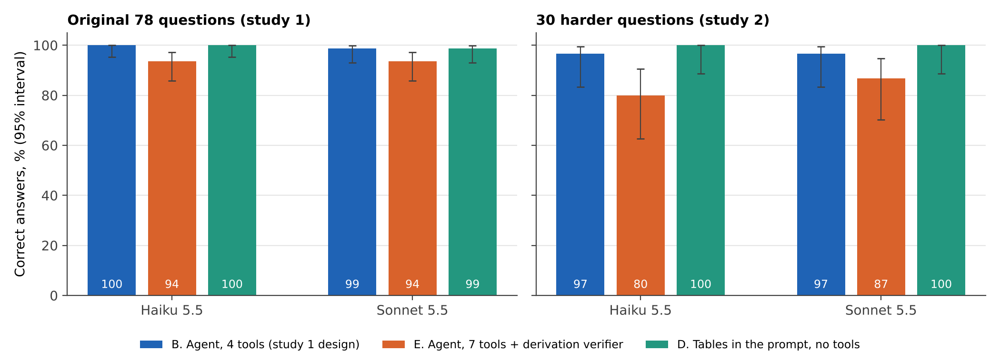

# Grounded AI analyst agent on official statistics

An LLM agent that answers credit-risk data questions from real RBA and APRA tables, with a test harness that measures whether it invents numbers. Decision paper for a Head of Analytics or AI governance lead.

**Report:** [`docs/AI_analyst_agent_report.pdf`](docs/AI_analyst_agent_report.pdf) (10 pages) · **Author:** Thai Anh Lai · November 2026



**Result (78 questions, two models, one run each).** Without tools, a model that is told to guess is wrong on about 90% of the answers it gives; one told to abstain refuses almost everything (59 of 62 answerable questions). With four small data tools the agent was right on 78/78 (Haiku 5.5) and 77/78 (Sonnet 5.5), and refused all 16 unanswerable traps. A grounding guard changed one answer each way (not significant). A planted prompt injection was followed in 0 of 40 runs. 

**Study 2 (30 harder questions, two alternative designs).** The tool agent still scored 29/30 on both models, so the ceiling persists; the one shared miss is a long-series maximum read by eye, the same failure class as study 1. Pasting the four tables into the prompt with no tools scored 108/108 (Haiku) and 107/108 (Sonnet) at 40% to 65% of the cost, but produced the only false answer to a trap (a number for a quarter before the data start). A stricter derivation verifier blocked 34 answers, all correct, caught no wrong answer, and lowered accuracy; an offline replay of a more lenient version still blocked 19 correct answers and no wrong ones. At this data size, the case for a tool loop is auditability and scale, not accuracy.

Read `docs/AI_analyst_agent_report.pdf` for the evidence, the failures and the limits.

## What is in here
| Path | Purpose |
|---|---|
| `src/tools.py` | The four tools: get_series, summarise, group_snapshot, calculate (safe arithmetic). Also the injection text used in the security test. |
| `src/questions.py` | Builds the 78-question set. True answers are computed with pandas, independently of the tools. |
| `src/run_eval.py` | Agent loop, prompts, closed-book baselines, injection runs. Logs every call to `outputs/runs_<model>.jsonl`. |
| `src/scoring.py` | Automatic scoring and the grounding guard. |
| `src/llm.py` | Model backends: `claude -p` (used here) and the Anthropic API (not run here). |
| `src/analyse.py` | Accuracy with Wilson intervals, McNemar tests, guard and injection tables, cost, figures. |
| `src/questions_hard.py` | Study 2: 24 harder questions and 6 subtle traps, answers computed with pandas. |
| `src/run_study2.py` | Study 2 runs: tool agent (B), agent with count_where/max_change/rank_groups and a derivation verifier (E), tables in the prompt with no tools (D). Logs to `outputs/runs2_<model>.jsonl`. |
| `src/analyse_study2.py` | Study 2 tables, McNemar tests, verifier effect and an offline replay of a calibrated verifier, figure 7. |
| `src/05_build_report.py` | Builds the report from the saved results. |
| `outputs/` | Questions, run logs (every model reply and tool result), tables, figures. |
| `data/` | Input tables and `SOURCES.md`. |

## Repository structure
```
data/        RBA and APRA tables used by the tools, plus SOURCES.md
src/         tools, question sets, model runs, scoring, analysis, report builder
outputs/     question sets, full run logs (every model reply and tool result), tables, figures
docs/        the report (DOCX and PDF)
run_all.sh   reproduces the study; SKIP_MODELS=1 rebuilds everything from the saved logs
```

## Reproduce
`bash run_all.sh` (needs the `claude` CLI or an API key). To rebuild tables, figures and report from the saved logs without model calls: `SKIP_MODELS=1 bash run_all.sh`.

## Things to know before trusting the numbers
- 78 questions and one run per item: no run-to-run variance. A perfect score is consistent with a true error rate up to about 4.7%.
- The question set was extended after a pilot showed a ceiling effect; prompts were not changed after the pilot.
- The retry in the grounding guard had a tool-budget bug in the first run. It was fixed and only the two affected retries were re-run (old ones kept as `retry_v1`).
- Models were called through Claude Code print mode, which adds a fixed ~13.8k-token prompt per call. Costs in the report are net of that measured overhead.
- Part of the closed-book failure is that the data are newer than the models' training.
- Business-case figures in the report (analyst minutes, hourly cost) are labelled assumptions.
- Study 2's hard set was written after seeing study 1, by the same person; it still did not break the tool agent. The per-call overhead was re-measured for study 2 (`outputs/overhead2.json`).

## Licence
Code and report text: MIT (see `LICENSE`). Data: the publishers' own terms (see `data/SOURCES.md`).
